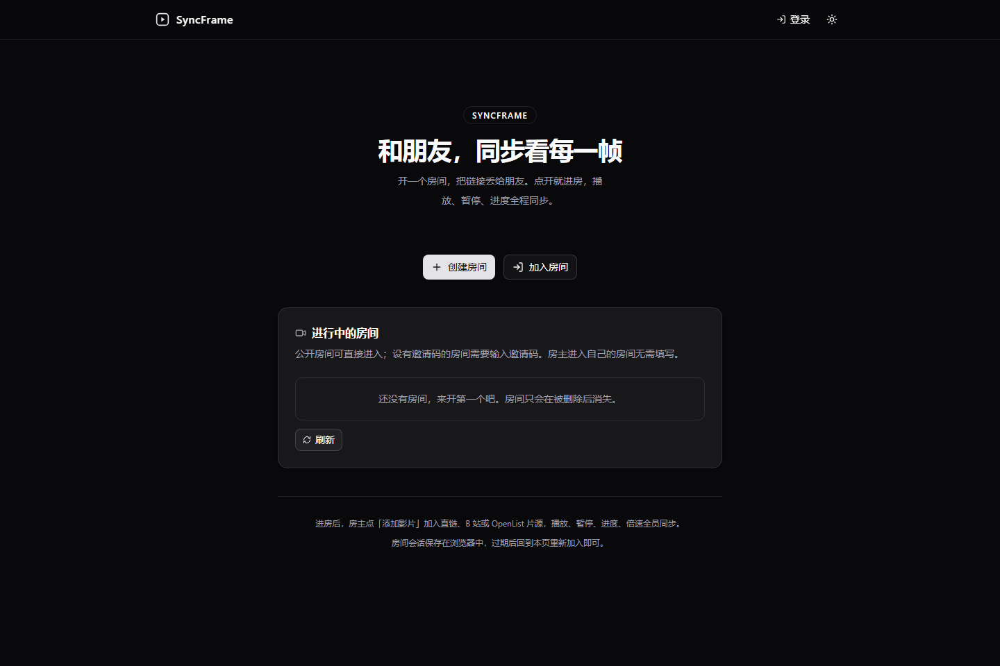

# SyncFrame

基于 **Movi Player** 的多人同步观影室。房主添加直链、B 站或 OpenList 影片，观众通过邀请链接进房，播放、暂停、进度和倍速由房主统一控制。

| 大厅 | 观影房间 |
| --- | --- |
|  |  |

## 按界面操作

### 1. 登录并创建房间

1. 打开 SyncFrame 大厅，点击右上角 **「登录」**。
2. 输入管理员分配的账户和密码。未登录时点击 **「创建房间」** 也会打开登录窗口。
3. 点击大厅的 **「创建房间」**。
4. 在弹窗中填写 **房间名**。
5. 默认会为房间设置邀请码：可以留空自动生成，也可以填写 4–16 位字母或数字。取消勾选 **「设置邀请码」** 可创建公开房间。
6. 点击弹窗底部的 **「创建房间」**，进入观影房间并成为房主。

大厅的 **「进行中的房间」** 会显示房间名、房主、在线人数和视频数量，点击 **「刷新」** 可更新列表。公开房间可直接加入；自己的房间无需填写邀请码。

### 2. 邀请朋友

进入房间后，点击右上角 **「邀请」** 展开邀请链接：

- 点击 **「复制链接」**，把完整链接发给朋友；对方打开后会自动进房。
- 点击 **「重置链接」** 可生成新邀请码，旧链接立即失效，已在房间内的成员不受影响。

朋友也可以在大厅点击 **「加入房间」**，输入房主提供的邀请码。游客可填写昵称，留空则由系统生成；登录用户使用账户名。随后点击弹窗中的 **「加入房间」**。

### 3. 添加并播放影片

只有房主可以添加影片、切换播放列表和控制同步播放。在右侧 **「播放列表」** 卡片中点击 **「＋ 添加影片」**，通过弹窗选择以下来源。

#### 直链

1. 选择 **「直链」** 页签。
2. 可选填视频名称，粘贴以 `http://` 或 `https://` 开头的视频地址。
3. 点击 **「添加到播放列表」**。
4. 关闭弹窗，在播放列表中点击该条目或 **「播放」**。

#### B 站链接

1. 先在 **「账户设置 → 视频源 → 哔哩哔哩」** 扫码登录 B 站。
2. 回到添加影片弹窗，选择 **「B 站链接」** 页签。
3. 粘贴 B 站链接或 BV / av 号，也支持 ep / ss 番剧链接。
4. 点击 **「添加到播放列表」**，再关闭弹窗开播。

B 站功能仅限 SyncFrame 登录用户。完整凭据只保存在当前浏览器，服务端仅按请求进行扫码、续期和播放地址解析，不保存凭据，也不通过云端代理视频字节。

#### OpenList 媒体库或路径

先在 **「账户设置 → 视频源」** 中保存自己的 OpenList 名称、地址、用户名和密码，然后打开添加影片弹窗：

- **「OpenList 媒体库」**：选择视频源，通过目录、上级目录、文件名搜索和分页查找视频，点击视频条目或 **「添加」**。
- **「OpenList 路径」**：选择视频源，输入完整文件路径，例如 `/movies/a.mkv`，再点击 **「添加到播放列表」**。

从媒体库选中的视频会加入播放列表并开始加载。OpenList 浏览和添加使用房间创建者本人配置的视频源；未配置 OpenList 时不会显示这两个页签。

### 4. 同步观影与房间管理

- **房主**：使用播放器控制播放、暂停、进度和倍速；点击播放列表条目切换全房间片源，点击垃圾桶图标移除条目。
- **观众**：播放器自动跟随房主。如果浏览器阻止自动播放，点击播放器中的 **「点击加入播放」**。
- **在线状态**：房间名旁显示身份、连接状态和当前片源；右侧统计合计、房主、成员和游客人数。
- **修改房间名**：房主点击房间名旁的铅笔图标。
- **删除房间**：房主点击右上角 **「删除房间」**；删除后无法恢复，所有成员都会被请出。
- **离开房间**：点击右上角 **「退出房间」** 返回大厅。

房间会话保存在浏览器会话存储中；会话过期后，返回大厅重新加入即可。

## 账户与视频源

- **游客**：无需账户，可通过邀请链接或邀请码进房观看，也可直接进入公开房间；不能创建房间或配置视频源。
- **登录用户**：可以创建房间，并管理自己的 OpenList 和 B 站视频源。
- **管理员**：通过环境变量初始化。注册已关闭，其他账户由管理员在 **「用户管理」** 中创建、删除或重置密码。

点击大厅右上角的用户名，可进入 **「账户设置」**；管理员还可进入 **「用户管理」**。OpenList 凭据保存在服务端；B 站完整凭据保存在当前浏览器的 `localStorage` 中，更换浏览器或设备后需要重新扫码。

## 本地运行

### 环境要求

- Node.js 22+
- pnpm（可执行 `npm install -g pnpm` 安装）

### 安装与配置

```bash
cd syncframe-poc
pnpm install
cp .env.example .env
```

Windows 可使用：

```bat
copy .env.example .env
```

编辑 `syncframe-poc/.env`，设置管理员账户：

```dotenv
ADMIN_USERNAME=admin
ADMIN_PASSWORD=请替换为强密码
```

### 启动

在 `syncframe-poc` 目录分别打开两个终端：

```bash
# 终端 1：后端，默认端口 8787
pnpm run p1:server
```

```bash
# 终端 2：前端，默认端口 5173
pnpm run p1:web
```

浏览器打开 <http://localhost:5173/>，然后按上方步骤创建或加入房间。

Windows 也可以双击 `scripts/dev.bat`，自动打开后端和前端两个窗口。

## Docker 部署

### 环境要求

- Docker
- Docker Compose v2

在仓库根目录创建 `.env`：

```dotenv
ADMIN_USERNAME=admin
ADMIN_PASSWORD=请替换为强密码
```

准备数据目录。Linux 首次部署时需要让容器内的 `node` 用户（UID 1000）可写：

```bash
mkdir -p syncframe-poc/data
sudo chown -R 1000:1000 syncframe-poc/data
```

启动服务：

```bash
docker compose up --build -d
```

浏览器打开 <http://localhost:7300/>。

常用命令：

```bash
docker compose ps             # 查看状态
docker compose logs -f server # 查看日志
docker compose up --build -d  # 修改代码后重新构建
docker compose down           # 停止并删除容器
```

账户、视频源配置和房间数据持久化在 `syncframe-poc/data/syncframe.db`。该文件包含敏感凭据，请妥善备份并限制访问权限；删除数据文件会重置数据。

### 反向代理

容器内由同一个 Node 服务提供前端、`/api` 和 `/ws`，默认映射为宿主机 `7300` → 容器 `8787`。如需修改对外端口，请调整 `docker-compose.yml` 中的端口映射。

公网部署请使用 Caddy、Traefik 或 Nginx 配置域名和 HTTPS，并确保支持 WebSocket Upgrade。B 站凭据会在浏览器与服务端之间传输，公网环境必须启用 HTTPS。

Caddy 示例：

```caddy
syncframe.example.com {
    reverse_proxy localhost:7300
}
```

健康检查：

```bash
curl http://localhost:7300/api/health
```

## 开发检查

以下命令均在 `syncframe-poc` 目录执行：

```bash
pnpm run typecheck   # 类型检查
pnpm run p2:sim      # 同步协议仿真
pnpm run p3:security # 安全测试
pnpm run p3:ui       # 大厅 UI 冒烟测试，需要本机 Chrome / Edge
pnpm run p4:unit     # Provider 与持久化单元测试
pnpm run p4:mobile   # 移动端布局检查，需要本机 Chrome / Edge
```

## 仓库结构

```text
SyncFrame/
├── syncframe-poc/
│   ├── apps/web/                # Vite 前端：大厅、房间、账户设置
│   ├── apps/server/             # Node 后端：REST、WebSocket、媒体解析
│   ├── packages/sync-protocol/  # 同步协议与漂移纠偏
│   ├── packages/openlist-adapter/
│   └── tests/                   # 协议、安全、E2E、UI 与移动端测试
├── deploy/server.Dockerfile     # 前端构建与后端运行的单容器镜像
├── docker-compose.yml           # 单服务部署
├── scripts/dev.bat              # Windows 本地启动脚本
├── shot-lobby.png               # 大厅截图
└── shot-room.png                # 房间截图
```
