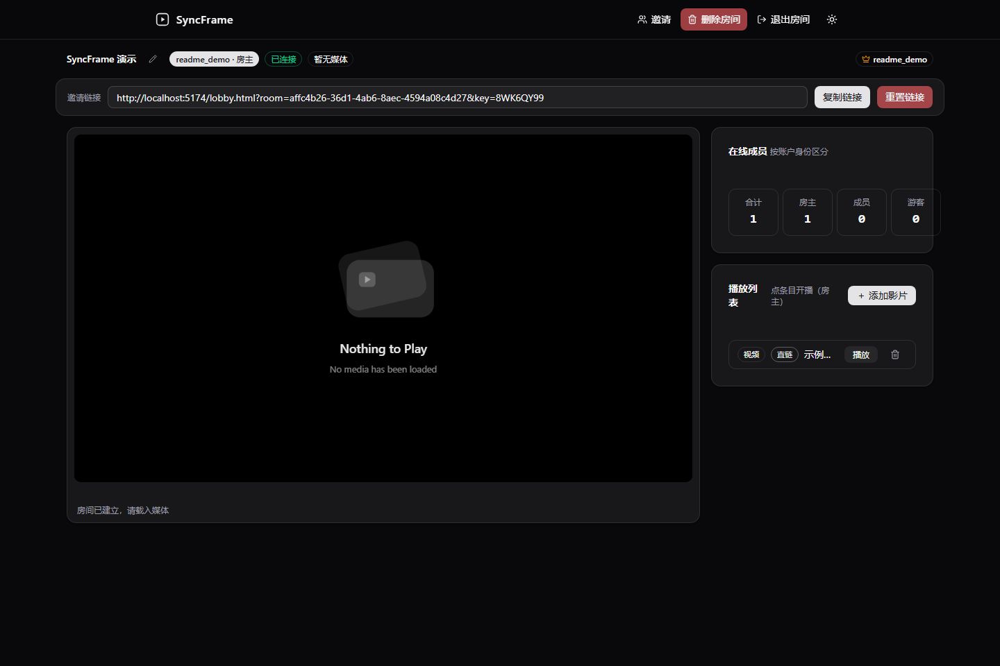

# SyncFrame

基于 **Movi Player** 的多人同步观影室。
房主添加视频（OpenList 媒体库 / B 站 / 直链），观众通过邀请链接进房，全房间播放/暂停/进度/倍速自动同步；
B 站登录、API 解析和 CDN 流量全部由每台设备上的本机助手处理：可直连时浏览器直拉 CDN，否则仅经 `127.0.0.1` 转发；云端只同步视频标识与播放状态，绝不代理 B 站视频。

| 大厅 | 观影房间 |
| --- | --- |
|  |  |

## 界面导览

**大厅（`/` → `lobby.html`）**

- 顶部标语与「同步房间」列表：展示本实例当前活跃的房间，可直接加入
- 「创建房间」：登录用户填写房间名即可成为房主（游客不可用）；系统生成 `r_` + 10 位字符的内部短 ID，仅在链接和接口参数中使用
- 「加入房间」：只输入全实例唯一的邀请码；无邀请码的公开房间可从列表直接进入；更常见的做法是直接点开房主分享的邀请链接自动进房

**观影房间（`room.html`）**

- 顶栏：房间名、房主/登录成员/游客身份、连接状态、当前播放来源，以及昵称菜单、邀请、退出房间
- 邀请链接：一键复制；「重置链接」让旧链接立即失效（已加入成员不受影响）
- 播放器：房主统一控制播放/暂停/进度/倍速，观众自动跟随
- 播放列表：点击条目即全房间切换播放
- 添加影片（仅房主）：弹窗内四种方式——直链、B 站链接（BV / av / ep / ss）、OpenList 路径、OpenList 媒体库浏览（目录、搜索、分页）
- OpenList 选片面板：房主可直接在房间内浏览媒体库并添加

## 权限模型

- **游客（无需账户）**：凭邀请链接 / 邀请码加入受保护房间，或直接进入公开房间；不能创建房间、不能配置 provider；名册明确标记为「游客」
- **用户（登录）**：以账户用户名加入并标记为「登录成员」；可创建房间，创建者每次凭账户重进都自动恢复「房主」身份且无需邀请码，其他登录用户与游客一样需要邀请码；在「账户设置」（顶栏昵称 → `/settings.html`）中保存自己的 OpenList 凭据（服务端 `./data`，对外不回显）；**B 站会话只保存在本机助手**，云端与浏览器 localStorage 均不保存 Cookie
- **管理员**：由部署时的环境变量初始化，**注册已关闭**——全部账户由管理员创建 / 删除 / 重置密码
- 房间的 OpenList 浏览/添加只允许使用**房间创建者本人**的 provider

## 功能

- **同步房间**：登录用户创建房间、分享邀请链接，游客点开即进房
- **播放列表**：房主可添加直链视频、粘贴 B 站链接（BV 号 / av 号 / 番剧 ep、ss），按 OpenList 路径添加，或在媒体库浏览器中点选；点击条目即全房间切换播放
- **账户与 provider**：登录后在账户设置页配置自己的 OpenList provider；B 站由本机助手扫码登录，会话跨房间、标签页和助手重启复用，只有会话失效时才需重新扫码
- **B 站画质与地区权限**：必须登录，按每位观看者自己的账号与网络解析；不提供匿名播放。地区限制不会因本机直连而消失，也不会由云端代为绕过
- **移动端自适应**：窄屏单列布局、防 iOS 输入聚焦缩放、加大点按目标
- **精同步**：时钟偏移估计 + 漂移纠偏，播放/暂停/seek/倍速由房主统一控制，观众自动跟随
- **安全模型**：账户身份与房间角色分离，成员令牌鉴权、媒体注册为不透明 mediaId、邀请链接可随时重置；本机助手仅监听回环地址、校验网页来源，B 站播放票据仅存在本机内存且不接受任意上游 URL

## 仓库结构

```text
SyncFrame/
├── syncframe-poc/            # 全部代码（npm workspaces：apps + packages + tests）
│   ├── apps/web/             # Vite 前端：入口 /（重定向至大厅）· 大厅 lobby.html · 房间 room.html · 账户设置 settings.html
│   ├── apps/server/          # 云端：REST 鉴权 + WebSocket 同步 + OpenList + 静态资源托管（无 B 站登录/解析/代理）
│   ├── apps/local/           # 本机助手：B 站扫码、私有会话、API 解析、CDN 直连失败时的本机转发
│   ├── packages/sync-protocol/# 同步协议包（时钟偏移、跟随纠偏、消息校验）
│   ├── packages/openlist-adapter/ # OpenList API 适配器
│   └── tests/                # 自动化测试（协议仿真 / 安全 / e2e / UI 冒烟 / provider 单测 / 移动端检查）
├── deploy/server.Dockerfile  # 单容器镜像（前端构建 + 后端运行，单端口）
├── docker-compose.yml        # 一键部署（单个服务，端口映射给自行反向代理）
├── scripts/                  # 本地开发辅助脚本
│   └── dev.bat               # Windows 一键拉起后端 + 前端开发服务器（等价于方式一的两个终端）
└── .github/workflows/        # CI/CD（push 到 main 自动 SSH 到服务器 git pull + 重建容器）
```

## 快速开始

前置：Node.js 22+ 与 npm（本地调试）；Docker 与 Docker Compose v2（容器部署）。

### 方式一：npm 本地调试

```bash
cd syncframe-poc
npm install
cp .env.example .env        # Windows: copy .env.example .env
```

编辑 `syncframe-poc/.env`，设置管理员账户（**必填，注册已关闭**）：

| 变量 | 说明 |
| --- | --- |
| `ADMIN_USERNAME` / `ADMIN_PASSWORD` | 启动时初始化的管理员账户；之后用它登录，在「账户管理」中创建其他账户 |

> OpenList 凭据**不在 env 配置**：各账户登录后在账户设置页（顶栏昵称 → 账户设置）自行填写，凭据只存服务端。  
> **B 站会话**：每台观看设备运行本机助手，在账户设置页「哔哩哔哩」扫码。Cookie 由助手写入 `data/local/bilibili-session.json`（仅本机，POSIX 文件权限 0600），不会返回网页或上传云端；同一台设备的房间、标签页和 SyncFrame 账户共用一次登录。换设备仍需扫码，B 站正式使会话失效时也需重新扫码。
>
> 数据持久化：云端账户（含 OpenList 凭据）与房间写入 `./data/`（`DATA_DIR` 可改，已 gitignore），重启保留；删除该目录会同时重置云端数据与本机 B 站会话。用户令牌仍为内存态，云端重启后需重新登录。

**启动（三个终端）：**

```bash
# 终端 1：云端（REST + WS 同步房间 + OpenList 代理），默认 :8787
npm run p1:server

# 终端 2：前端 Vite 开发服务器，默认 :5173（/api、/ws 已代理到 8787）
npm run p1:web

# 终端 3：本机 B 站助手，只监听 127.0.0.1:8788
npm run p1:local
```

打开 http://localhost:5173/ → 登录 SyncFrame → 账户设置中扫码登录 B 站 → 创建房间并分享邀请链接。观众也需要在自己的设备运行 `npm run p1:local` 并登录 B 站，才能观看 B 站条目。

Windows 下也可以直接双击 `scripts/dev.bat`，会自动开三个窗口分别跑云端、前端和本机助手。

**开发：**

- Vite 自带 HMR，改前端即热更新；代理配置在 `apps/web/vite.config.ts`
- 改后端代码用 `npx tsx watch --env-file-if-exists=.env apps/server/src/index.ts` 自动重启
- 类型检查：`npm run typecheck`
- 同步协议仿真：`npm run p2:sim`；安全测试：`npm run p3:security`
- 前端冒烟测试：`npm run p3:ui`（需本机 Chrome/Edge）
- provider 单测：`npm run p4:unit`；移动端布局检查：`npm run p4:mobile`（需本机 Chrome/Edge）

### 方式二：Docker 构建并部署

在**仓库根目录**（含 `docker-compose.yml` 的目录）执行：

```bash
docker compose up --build -d
```

构建并启动单个容器，然后浏览器打开 http://localhost:7300/（自动进入大厅）。

管理员账户通过环境变量注入（**不写入镜像**）。在仓库根目录建一个 `.env`
（compose 会自动读取，该文件已被 gitignore）：

```bash
ADMIN_USERNAME=admin
ADMIN_PASSWORD=your_strong_password
```

或直接 export 后运行 `docker compose up --build -d`。
启动后用该管理员登录，在「账户管理」中创建观影账户；账户再自行配置 OpenList。Docker 只部署云端，不包含观看设备的本机助手。

**B 站观看者配置**：每位观看者在本地检出仓库并运行 `npm install && npm run p1:local`。公网页面的来源默认不在助手白名单中，启动前需设置实际来源，例如：

```bash
SYNCFRAME_WEB_ORIGINS=https://syncframe.example.com npm run p1:local
```

然后在 SyncFrame 账户设置中扫码。浏览器连接的是 `127.0.0.1:8788`，不是云端服务器；不要把助手端口暴露到局域网或公网。

**单容器架构**（不内置 nginx，只暴露一个端口供自行反向代理）：

```text
浏览器 ──→ server（node:22-alpine，单端口 :8787，镜像内已构建前端产物）
            ├─ 静态托管 Vite 构建产物（/ 自动进入大厅）
            ├─ /api 账户/房间鉴权 + OpenList 解析 + B 站同步标识（无 B 站登录/流地址）
            └─ /ws  WebSocket 同步房间（长连接）

观看设备浏览器 ──→ 127.0.0.1 本机助手 ──→ B 站 API / CDN
                   （Cookie 不出本机；必要时仅在本机转发 CDN 字节）
```

镜像在同一阶段完成前端构建（`npm run build -w @syncframe/web`），
后端经 `WEB_DIST` 环境变量托管构建产物（`deploy/server.Dockerfile` 已内置）。

**反向代理（由部署者自行设置）**：编排只把宿主机 `7300` 映射到容器 `8787`，
不内置任何 Web 代理。域名 / HTTPS / 访问控制请在最外层自行反代
（Caddy / Traefik / Nginx 均可），注意 `/ws` 需要 Upgrade 长连接。
Caddy 示例：

```
syncframe.example.com {
    reverse_proxy localhost:7300
}
```

**常用命令：**

```bash
docker compose logs -f server   # 看日志
docker compose ps               # 查看容器状态
docker compose down             # 停止并删除容器
docker compose up --build -d    # 改了代码后重新构建并启动
```

**部署注意：**

- 对外端口改 `docker-compose.yml` 里 ports 的 `"7300:8787"` 映射
- 反向代理与 HTTPS 在最外层配置（见上）；B 站 Cookie 不经过云端，但 SyncFrame 账户令牌仍需 HTTPS 保护
- `./data` 卷持久化账户/房间（含 OpenList 凭据）：重启容器不丢数据，**注意备份与权限**（不要挂到公共目录）；删除卷内容即重置
- 容器以 `node`（uid 1000）运行：首次部署前需 `mkdir -p data && sudo chown -R 1000:1000 data`，否则账户/房间无法落盘
- 容器带 `restart: unless-stopped`，宿主机重启后自动拉起

**自动部署（GitHub Actions）：**

`.github/workflows/deploy.yml` 在 push 到 `main` 时通过 SSH 登录服务器执行 `git pull && docker compose up -d --build`。
需要在仓库 Settings → Secrets and variables → Actions 配置 `DEPLOY_HOST` / `DEPLOY_USER` / `DEPLOY_SSH_KEY`
（专用部署密钥，公钥追加到服务器 `~/.ssh/authorized_keys`；脚本内服务器路径为 `/opt/stacks/SyncFrame`）。
