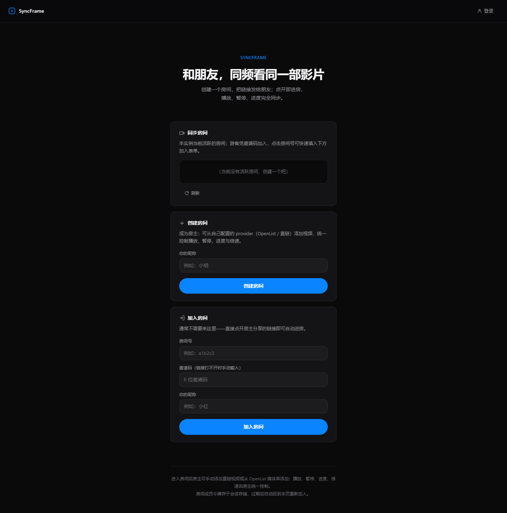
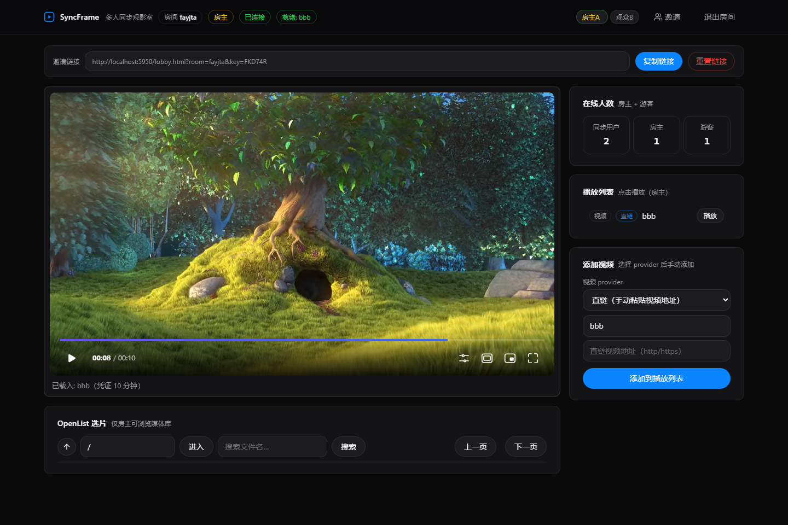

# SyncFrame

基于 **Movi Player** 的多人同步观影室。
房主添加视频（OpenList 媒体库 / B 站 / 直链），观众通过邀请链接进房，全房间播放/暂停/进度/倍速自动同步；
OpenList 媒体字节由播放器直连拉取，Bilibili 流经服务端反代（代发 Referer、透传 Range）。

| 大厅 | 观影房间 |
| --- | --- |
|  |  |

## 权限模型

- **游客（无需账户）**：只能凭邀请码加入房间观看；不能创建房间、不能配置 provider
- **用户（登录）**：可创建房间；在「我的视频 provider」中保存自己的 OpenList 凭据 / Bilibili SESSDATA（只存服务端内存）
- **管理员**：由部署时的环境变量初始化，**注册已关闭**——全部账户由管理员创建 / 删除 / 重置密码
- 房间的 OpenList 浏览/添加只允许使用**房间创建者本人**的 provider

## 功能

- **同步房间**：登录用户创建房间、分享邀请链接，游客点开即进房
- **播放列表**：房主可添加直链视频、粘贴 B 站链接（BV 号），或从自己账户的 OpenList 媒体库中选择；点击条目即全房间切换播放
- **账户与 provider**：登录后配置自己的 OpenList / Bilibili provider；B 站流由服务端反代
- **移动端自适应**：窄屏单列布局、防 iOS 输入聚焦缩放、加大点按目标
- **精同步**：时钟偏移估计 + 漂移纠偏，播放/暂停/seek/倍速由房主统一控制，观众自动跟随
- **安全模型**：成员令牌鉴权、媒体注册为不透明 mediaId、短期签名地址授权、邀请码可重置

## 仓库结构

```text
SyncFrame/
├── syncframe-poc/            # 全部代码（npm workspaces：apps + packages + tests）
│   ├── apps/web/             # Vite 前端：入口 /（重定向至大厅）· 大厅 lobby.html · 房间 room.html
│   ├── apps/server/          # Node 后端：REST 鉴权 + WebSocket 同步房间 + provider 媒体解析 + 静态资源托管
│   ├── packages/sync-protocol/# 同步协议包（时钟偏移、跟随纠偏、消息校验）
│   ├── packages/openlist-adapter/ # OpenList API 适配器
│   └── tests/                # 自动化测试（协议仿真 / 安全 / e2e / UI 冒烟 / provider 单测 / 移动端检查）
├── deploy/server.Dockerfile  # 单容器镜像（前端构建 + 后端运行，单端口）
└── docker-compose.yml        # 一键部署（单个服务，端口映射给自行反向代理）
```

## 快速开始

前置：Node.js 22+ 与 npm（本地调试）；Docker 与 Docker Compose v2（容器部署）。

### 方式一：npm 本地调试

```bash
cd syncframe-poc
npm install
cp .env.example .env        # Windows: copy .env.example .env
```

编辑 `syncframe-poc/.env`，设置管理员账户（**必填，注册已关闭**）：

| 变量 | 说明 |
| --- | --- |
| `ADMIN_USERNAME` / `ADMIN_PASSWORD` | 启动时初始化的管理员账户；之后用它登录，在「账户管理」中创建其他账户 |

> OpenList / Bilibili 凭据**不在 env 配置**：各账户登录后在大厅「我的视频 provider」里自行填写，凭据只存服务端内存。

**启动（两个终端）：**

```bash
# 终端 1：后端（REST + WS 同步房间 + OpenList 代理），默认 :8787
npm run p1:server

# 终端 2：前端 Vite 开发服务器，默认 :5173（/api、/ws 已代理到 8787）
npm run p1:web
```

打开 http://localhost:5173/ → 登录 → 创建房间 → 把邀请链接发给观众即可同步观影。

**开发：**

- Vite 自带 HMR，改前端即热更新；代理配置在 `apps/web/vite.config.ts`
- 改后端代码用 `npx tsx watch --env-file-if-exists=.env apps/server/src/index.ts` 自动重启
- 类型检查：`npm run typecheck`
- 前端冒烟测试：`npm run p3:ui`（需本机 Chrome/Edge）
- provider 单测：`npm run p4:unit`；移动端布局检查：`npm run p4:mobile`（需本机 Chrome/Edge）

### 方式二：Docker 构建并部署

在**仓库根目录**（含 `docker-compose.yml` 的目录）执行：

```bash
docker compose up --build -d
```

构建并启动单个容器，然后浏览器打开 http://localhost:7300/（自动进入大厅）。

管理员账户通过环境变量注入（**不写入镜像**）。在仓库根目录建一个 `.env`
（compose 会自动读取，该文件已被 gitignore）：

```bash
ADMIN_USERNAME=admin
ADMIN_PASSWORD=your_strong_password
```

或直接 export 后运行 `docker compose up --build -d`。
启动后用该管理员登录，在「账户管理」中创建观影账户；账户再自行配置自己的 OpenList / Bilibili provider。

**单容器架构**（不再内置 nginx，只暴露一个端口供自行反向代理）：

```text
浏览器 ──→ server（node:22-alpine，单端口 :8787，镜像内已构建前端产物）
            ├─ 静态托管 Vite 构建产物（/ 自动进入大厅）
            ├─ /api 账户/房间鉴权 + provider 媒体解析 + 媒体授权
            └─ /ws  WebSocket 同步房间（长连接）
```

镜像在同一阶段完成前端构建（`npm run build -w @syncframe/web`），
后端经 `WEB_DIST` 环境变量托管构建产物（`deploy/server.Dockerfile` 已内置）。

**反向代理（由部署者自行设置）**：编排只把宿主机 `7300` 映射到容器 `8787`，
不内置任何 Web 代理。域名 / HTTPS / 访问控制请在最外层自行反代
（Caddy / Traefik / Nginx 均可），注意 `/ws` 需要 Upgrade 长连接。
Caddy 示例：

```
syncframe.example.com {
    reverse_proxy localhost:7300
}
```

**常用命令：**

```bash
docker compose logs -f server   # 看日志
docker compose ps               # 查看容器状态
docker compose down             # 停止并删除容器
docker compose up --build -d    # 改了代码后重新构建并启动
```

**部署注意：**

- 对外端口改 `docker-compose.yml` 里 ports 的 `"7300:8787"` 映射
- 反向代理与 HTTPS 在最外层配置（见上）；账户凭据与 provider 凭据只存容器内存，重启即失（PoC）
- 容器带 `restart: unless-stopped`，宿主机重启后自动拉起
