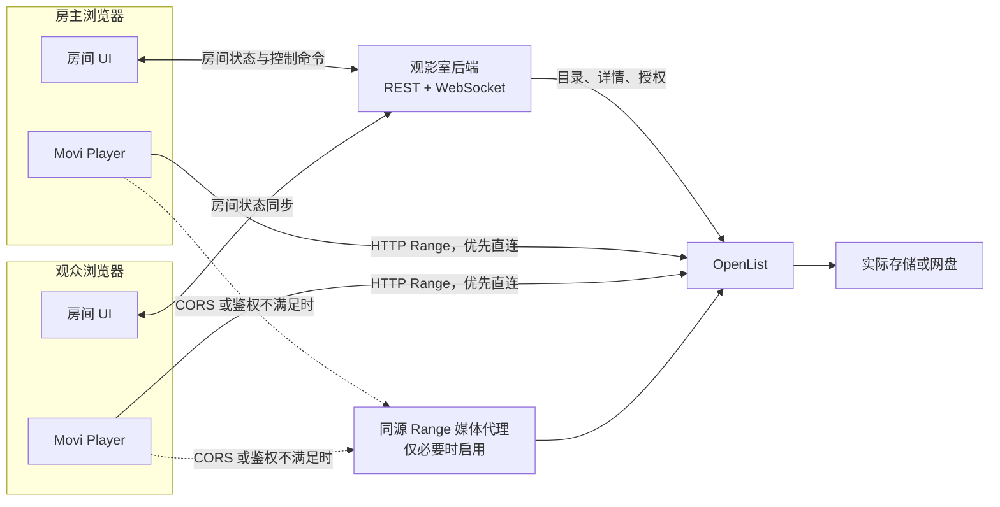

# 基于 Movi Player 与 OpenList 的多人同步观影室：可行性分析与验证项目计划

> 文档状态：验证前计划，尚未进行实际视频播放与多人同步测试  
> 调研日期：2026-10-26  
> 验证目标：先证明“OpenList 原始文件能够在浏览器中稳定播放”，再证明“多个浏览器能够稳定同步”，最后集成最小可用观影室。

---

## 1. 执行摘要

### 1.1 初步结论

项目**技术上可行，但可行性是有条件的**。推荐采用“每个客户端独立读取同一视频文件，服务端只同步播放状态”的架构：

- **Movi Player**：在浏览器端完成 MKV、MP4、AVI 等文件的解封装和解码，支持多音轨、多字幕，不要求服务端转码。
- **OpenList**：提供文件列表、文件元信息和原始文件 URL，本身不作为同步观影服务端。
- **同步服务端**：维护房间、权限和权威播放状态，通过 WebSocket 分发播放、暂停、跳转、倍速和换片命令。
- **视频数据**：优先由各客户端直接从 OpenList 或其实际存储地址下载；直连不满足 CORS、Range 或鉴权要求时，再通过同源媒体代理读取。

Movi Player 仓库当前已有一个 Watch Party 原型，包含 WebSocket 房间、服务端时间戳、客户端时钟偏移估算、迟到加入、断线重连、漂移纠正、音轨和字幕状态同步等逻辑。验证项目应优先复用并审计该原型，而不是从零实现同步协议。

SyncTV / SyncTV App 已覆盖完整同步观影场景，可作为房间权限、播放状态、媒体 Provider 和异常处理的参考；但其当前技术栈和完整服务能力超出最小验证所需，**不建议第一阶段直接引入整套 SyncTV 服务端**。

### 1.2 最大风险不在“房间同步”，而在“原始文件播放”

以下因素会直接决定项目是否成立：

1. OpenList 最终返回的文件地址是否支持浏览器跨域读取和 HTTP Range。
2. 网盘或存储源是否支持随机 Range、重定向后的 Range，以及多客户端并发读取。
3. 高码率 4K、HEVC 10-bit、AV1 或软件解码回退是否导致客户端卡顿和高资源占用。
4. MKV 内嵌 ASS、PGS 等字幕及多音轨在实际样本上是否都能识别和切换。
5. 原始签名 URL 是否过期，以及是否存在 Hotlink 防护、请求头要求或下载限流。

因此必须设置明确的阶段门槛：**P0/P1 播放验证未通过，不进入完整产品开发。**

### 1.3 建议验证周期

预计 **11～18 人日**，由 1 名全栈工程师主导，另需 1 名协助者提供第二台设备或跨网络测试。若 OpenList 环境、测试文件和测试设备已准备好，可压缩日历周期。

---

## 2. 项目目标与边界

### 2.1 目标

构建一个多人可通过浏览器访问的在线同步观影室：

1. 房主从 OpenList 目录中选择视频并创建房间。
2. 观众通过房间链接加入，独立加载同一视频。
3. 房主控制播放、暂停、进度跳转、倍速和换片，观众自动跟随。
4. 观众中途加入或断线重连后，恢复到房间当前位置。
5. 支持 MKV、MP4、AVI 等常见容器及其实际音视频编码。
6. 支持多音轨和内嵌/外挂字幕，至少允许每个观众自行选择。
7. 全程使用原始文件，不把服务端转码作为默认前提。

### 2.2 验证阶段的默认假设

这些假设用于制定计划，不阻塞文档编写；执行前应确认：

- 首期以桌面版 Chrome / Edge 为主，Firefox 为兼容性验证对象。
- 单房间以 2～5 人为常规场景，12 人为验证上限。
- 每个观众都能访问观影室服务，但不一定拥有 OpenList 账号。
- 房间状态、播放进度和当前片源共享；音量、音轨、字幕和字幕偏移默认由观众本地控制。
- 首期只有房主拥有控制权，不做多人同时控制。
- 视频已获合法访问和分享授权。

### 2.3 非目标

第一阶段不做：

- 视频转码、实时转码或 HLS 切片。
- 把房主浏览器作为视频上传源或 SFU。
- 语音、摄像头、弹幕、聊天室、推荐系统。
- 原生 Android / iOS / 桌面客户端。
- 多节点集群和大规模直播。
- 对不支持文件进行自动修复或重新封装。

---

## 3. 参考项目分析

| 项目 | 可复用能力 | 对本项目的价值 | 不能直接假设的部分 |
| --- | --- | --- | --- |
| Movi Player | Web Component；FFmpeg WASM + WebCodecs；HTTP Range；MKV/MP4/AVI；多音轨；SRT/ASS/WebVTT/PGS 等字幕；硬件解码优先、软件回退；Watch Party 原型 | 作为播放器与同步客户端基础，减少播放器及房间原型开发量 | 仓库功能声明不等于实际样本、设备和网盘链路上的性能保证 |
| OpenList | 多存储挂载；目录和文件 API；`raw_url`；代理或直链；文件签名；相关文件信息 | 作为首期媒体库和文件访问层 | 不同驱动的直链、CORS、Range、签名时效、限流能力不同 |
| SyncTV App / SyncTV | 房间、权限、播放状态、媒体 Provider、断线恢复、时钟与漂移纠正思路 | 作为产品行为和同步协议参考，后续可评估深度集成 | 不应为了最小 Web 验证直接引入完整 Flutter/Rust/数据库体系 |

### 3.1 Movi Player 已有 Watch Party 原型的关键点

当前实现已经包含：

- 每个房间对应一个 Durable Object，通过 WebSocket 通信。
- 媒体流不经过房间，只传递播放状态。
- 服务端为状态消息打时间戳，客户端通过 ping/pong 和最短 RTT 样本估算时钟偏移。
- 房主定期发送进度心跳，操作命令立即发送。
- 跟随端按“基准进度 + 经过的服务端时间 × 倍速”计算目标进度。
- 偏差超过阈值时执行硬跳转；新成员收到最近一次状态。
- 包含控制权、成员列表、断线重连、自动播放受限处理和消息校验。

这说明项目已有较好的起点，但仍需验证并调整：

- 原型单房间上限为 12 人，且依赖 Cloudflare Durable Objects。
- 原型会广播原始 `src`；本项目应改成广播不透明 `mediaId`，避免签名 URL 或内部路径泄露。
- 原型允许授权其他成员控制；最小版本可简化为仅房主控制。
- 原型同步音轨和字幕；本项目默认改为本地选择，避免不同语言需求互相覆盖。
- 浏览器缓冲、后台标签页、解码缓慢时，不能简单把每次状态都当作房主主动操作。
- 房间持久化、用户鉴权和媒体授权仍需单独设计。

### 3.2 OpenList 接口边界

OpenList 当前文件接口可提供：

- 目录列表及分页信息。
- 文件大小、名称、签名等信息。
- 文件详情中的 `raw_url`。
- 视频相关文件 `related`，可用于发现同目录外挂字幕。
- 根据存储配置返回实际直链或 OpenList 代理地址。

因此不需要修改 OpenList 核心即可完成第一版适配。观影室后端应使用公开 HTTP API 对接，并锁定实际部署版本的接口契约。

### 3.3 许可证注意事项

- Movi Player：Apache-2.0。
- SyncTV App：Apache-2.0；SyncTV 服务端：MIT。
- OpenList：AGPL-3.0。

优先通过公开 HTTP API 与 OpenList 集成。若复制或修改其源代码，需在实施前单独评估相应许可证义务；本文不替代法律意见。

---

## 4. 推荐技术方案

### 4.1 总体架构



### 4.2 职责划分

| 模块 | 职责 |
| --- | --- |
| Web 房间端 | 登录/访客加入、OpenList 文件浏览、房间成员、播放器、同步状态展示、错误提示 |
| 观影室后端 | 用户和房间鉴权、媒体权限、状态定序、服务端时间、断线恢复、审计日志 |
| OpenList 适配器 | 封装登录、目录列表、文件详情、相关字幕、原始地址解析和错误标准化 |
| 媒体代理 | 同源转发 GET/HEAD 和 Range；不转码、不整文件缓存；只在直连不可用时启用 |
| Movi Player | 解封装、解码、渲染、音轨/字幕管理、播放事件和性能数据 |

### 4.3 验证项目的技术选型

为降低联调成本，建议：

- 前端：TypeScript + 轻量 Web 框架 + `movi-player`。
- 后端：TypeScript + Node.js，REST + 原生 WebSocket。
- 验证期存储：SQLite；需要多实例时再引入 PostgreSQL / Redis。
- 测试：Playwright 多浏览器上下文 + 真实人工双设备测试。
- 媒体信息：ffprobe 仅用于记录样本参数和诊断，不参与播放链路。
- 部署：Docker Compose；HTTPS/WSS 由反向代理终止。

Movi 的 Durable Object 原型可作为协议和客户端逻辑参考。若目标部署本身就是 Cloudflare，也可先做一版兼容验证，但不应让验证结论绑定单一平台。

### 4.4 媒体访问策略

按以下顺序验证和选择：

1. **OpenList 代理地址直连**：同源配置最容易统一，但会占用 OpenList 带宽。
2. **实际存储直链**：可减少 OpenList 流量，但必须验证 CORS、Range、签名时效和防盗链。
3. **观影室同源媒体代理**：当跨域或请求头无法配置时作为兼容兜底。

代理必须：

- 支持 GET、HEAD 和单区间 Range。
- 保留 `206`、`Content-Range`、`Content-Length`、`Accept-Ranges` 等响应语义。
- 使用流式转发，不将整个视频读入内存。
- 校验房间和媒体权限，限制可访问的 OpenList 路径。
- 防止任意 URL 代理和 SSRF。
- 对过期签名重新解析，不在日志中记录完整令牌。

### 4.5 房间状态模型

WebSocket 中不直接传原始媒体 URL，建议最小状态如下：

```json
{
  "roomId": "room_01",
  "revision": 42,
  "mediaId": "media_abc",
  "mediaRevision": 3,
  "paused": false,
  "positionMs": 612340,
  "rate": 1,
  "serverTimeMs": 1793049600000,
  "actorId": "host_01",
  "action": "seek"
}
```

其中：

- `revision` 单调递增，用于丢弃乱序或过期消息。
- `mediaId` 是观影室内部标识，客户端通过授权接口换取播放地址。
- `mediaRevision` 防止换片后旧片消息覆盖新片。
- `positionMs` 是操作发生时的媒体位置。
- `serverTimeMs` 是服务端接收并确认状态的时间。
- 生产实现还需处理服务端系统时钟回拨；可使用单调时钟计算时间差，或将其封装在房间时钟模块中。

跟随端目标位置：

```text
target = positionMs
       + (paused ? 0 : max(0, serverNow - serverTimeMs) × rate)
```

### 4.6 同步策略

最小版本采用“立即命令 + 周期心跳 + 超阈值硬纠正”：

- 播放、暂停、跳转、倍速、换片立即广播。
- 房主每 5～10 秒发送一次状态心跳。
- 客户端周期性估算服务端时钟偏移。
- 偏差小于约 1 秒时不反复 seek，避免画面抖动和额外流量。
- 超过阈值时 seek；新加入、重连和换片时强制对齐。
- 等待数据、解码失败和浏览器自动播放拦截属于观众本地状态，不能反向暂停全房间。
- 后续如需更平滑体验，再验证小偏差的短时倍速微调，不放入首个验证版本。

### 4.7 加入、缓冲与房主离开

**新观众加入顺序：**

1. 加入房间并取得最新状态。
2. 根据 `mediaId` 获取媒体地址。
3. 等待元数据可用，设置音轨/字幕本地偏好。
4. seek 到目标位置，等待 `seeked` 或可播放状态。
5. 尝试播放；若浏览器阻止自动播放，显示“点击加入播放”。
6. 就绪后重新计算一次目标位置并校正。

**房主离开：**

- MVP 建议进入暂停状态并保留 30 秒重连宽限期。
- 超过宽限期可结束房间或明确执行房主转移。
- 不默认沿用原型的“自动提升最早观众”，避免控制权与媒体权限不一致。

---

## 5. 验证项目设计

### 5.1 验证原则

1. 先验证文件访问，再验证播放器，最后验证同步。
2. 使用 OpenList 中的真实文件，不用本地静态服务器结果代替。
3. 每个问题都区分：文件本身、编码/解码、浏览器、OpenList、实际存储、网络或同步逻辑。
4. 保留原始测试数据，不能只记录“能播/不能播”。
5. 所有性能结论必须附带文件、设备、浏览器、网络和访问路径。
6. 至少使用两台真实设备完成最终同步验收，自动化浏览器不能完全代替人工测试。

### 5.2 环境准备

| 项目 | 要求 |
| --- | --- |
| OpenList | 一套测试实例；记录版本、存储驱动、Web Proxy / Must Proxy、签名和 CORS 配置 |
| 测试账号 | 最小只读权限；不使用管理员令牌作为长期浏览器配置 |
| 测试文件 | 6～10 个真实代表文件，另加边界样本；记录 ffprobe 信息 |
| 客户端 A | 主流 Windows/macOS 设备，硬件解码可用，Chrome / Edge |
| 客户端 B | 性能较弱或另一操作系统设备，用于异构同步测试 |
| 网络 | 局域网、模拟 WAN；至少覆盖 100 ms RTT、20 Mbps 限带宽、1% 丢包场景 |
| 观测 | 浏览器 Network/Performance、Movi Nerd Stats、后端日志、代理带宽与连接数 |

### 5.3 测试样本矩阵

实际文件应尽量来自日常使用场景。下表是最低覆盖建议：

| 编号 | 容器与编码 | 码率/结构重点 | 音轨与字幕 | 验证目的 |
| --- | --- | --- | --- | --- |
| V01 | MP4 + H.264 + AAC | 1080p，约 5～10 Mbps，fast start | 单音轨、无字幕 | 基线性能和原生/硬解路径 |
| V02 | MP4 + H.264 + AAC | `moov` 位于文件尾部 | 单音轨 | 文件尾部 Range 与打开速度 |
| V03 | MKV + H.264 + AC-3 | 1080p，长片 | 至少 2 条音轨，内嵌 SRT/ASS | 多音轨、音频解码、文本字幕 |
| V04 | MKV + HEVC 10-bit + E-AC-3 | 1080p 或 4K | 多音轨、多字幕 | HEVC 硬解/软解回退 |
| V05 | MKV + AV1 + Opus/FLAC | 4K 或高帧率 | 内嵌字幕 | AV1 设备差异与高负载 |
| V06 | AVI + MPEG-4 Part 2/Xvid + MP3 | 标清或 720p | 可配外挂 SRT | AVI 兼容与外挂字幕 |
| V07 | MKV + HEVC HDR | 4K，40～80 Mbps 或更高 | ASS/PGS | 高码率、HDR、图形字幕压力 |
| V08 | 任一真实 MKV/MP4 | 大于 20 GB、长于 2 小时 | 多轨优先 | 10%/50%/90% 位置 seek 和长时间内存 |
| V09 | MKV + 同目录 SRT/ASS | 普通码率 | 内嵌与外挂同时存在 | `related` 字幕发现和轨道冲突 |
| V10 | 已知异常或边缘文件 | 非标准时间戳、损坏索引等 | 不限 | 错误诊断，不作为必须支持项 |

说明：

- “支持 MKV/MP4/AVI”不能只按扩展名验收，必须同时记录实际编码、Profile、位深、帧率和音频格式。
- ASS 验证需覆盖字体、样式、定位和 libass/JASSUB 渲染路径；PGS 验证图像字幕显示和切换。
- V07 用于确定能力边界，不应因单个极端文件失败就否定整个方案。

---

## 6. 分阶段实施与验收

## P0：OpenList 文件访问与 HTTP 能力验证（1～2 人日）

### 任务

1. 部署并记录 OpenList 版本及存储配置。
2. 对接登录、目录列表和文件详情接口。
3. 获取 `raw_url`、`related`、文件大小和签名信息。
4. 分别测试 OpenList 代理地址和实际存储直链。
5. 对每种地址验证：
   - GET / HEAD。
   - 文件头、文件中部、文件尾部 Range。
   - 重定向后的 Range 是否仍正确。
   - 返回 206 还是忽略 Range 返回 200。
   - CORS 响应头及预检请求。
   - 签名过期、鉴权失败、防盗链和限流。
6. 至少建立 5 个并发读取会话，观察连接和下载稳定性。
7. 确定直连与媒体代理的优先级。

### 通过门槛

- 能稳定列出目录并解析目标文件。
- 核心样本所在存储支持正确的随机 Range；若不支持，已验证可用的同源代理兜底。
- 浏览器能跨域读取，或同源代理能完整保留 Range 语义。
- 连续读取和中途 seek 不导致整文件重新下载。
- 明确签名有效期和续期方式。

### 停止条件

若实际存储既不提供可用 Range，也无法通过 OpenList/自建代理恢复随机访问，则暂停并重新确定媒体源方案，不进入播放器性能结论。

### 产出

- OpenList 适配器最小实现。
- HTTP 能力检查脚本及原始响应记录。
- 《存储驱动兼容性表》。
- 直连/代理路线选择结论。

---

## P1：Movi Player 原始文件播放性能验证（3～5 人日）

### 任务

1. 建立不含房间逻辑的独立播放器测试页。
2. 固定 Movi Player 版本，优先使用 slim 构建并自托管 WASM。
3. 使用 P0 确定的真实 OpenList 地址播放 V01～V09。
4. 每个核心文件执行：
   - 冷启动和热启动。
   - 连续播放至少 15 分钟；长片抽测 30 分钟。
   - 10%、50%、90% 位置 seek，各重复 5 次。
   - 暂停/恢复、倍速、前后台切换。
   - 音轨切换、字幕切换、关闭字幕、字幕偏移。
5. 记录实际解码引擎、硬件/软件回退、网络流量和资源占用。
6. 对比直连与代理两条链路，避免把网络问题误判为解码问题。
7. 对失败文件执行本地文件对照测试，以区分文件/解码问题和 OpenList 链路问题。
8. 测试多客户端同时播放同一文件，观察网盘限流或 OpenList 代理瓶颈。

### 核心通过门槛

- V01、V03、V04、V06 等目标核心样本均可打开、播放、seek，无致命错误。
- 所有宣称纳入首发的音轨和字幕样本能枚举并正确切换。
- 主流硬解设备播放 1080p 核心样本时，30 分钟内无持续恶化的卡顿或内存增长。
- 播放期间不出现可稳定复现的整文件重新下载。
- 对高码率或软解失败样本形成明确的不支持清单或设备门槛。

### 产出

- 可重复运行的播放器验证页。
- 样本 ffprobe 清单。
- 性能原始数据（JSON/CSV）和汇总表。
- 格式、编码、字幕、音轨兼容矩阵。
- 失败样本最小复现与初步归因。

---

## P2：多人同步协议 Spike（2～3 人日）

### 任务

1. 提取并审计 Movi Watch Party 的客户端和房间逻辑。
2. 用 `mediaId + revision + 服务端时间` 替换原始 URL 广播。
3. 完成房主单控制权和观众只读模式。
4. 实现时钟偏移估算、状态心跳、硬漂移纠正和乱序消息丢弃。
5. 实现迟到加入、断线重连、换片和自动播放手势提示。
6. 把音轨和字幕改为观众本地选择，验证不被房间状态覆盖。
7. 使用 Playwright 启动多个独立浏览器上下文，采集各端播放器时间与服务端估算时间。
8. 注入 RTT、抖动、短时断网和后台标签页场景。

### 通过门槛

- 房主的播放、暂停、seek、倍速和换片能传播到全部在线观众。
- 普通网络稳定播放时，观众与房主进度差 P95 不超过 1 秒。
- 注入 100 ms RTT 时，进度差 P95 不超过 1.5 秒，且无持续累积漂移。
- seek 后观众在 2 秒内进入目标位置附近，不出现来回跳转。
- 新加入和重连能在媒体就绪后自动对齐。
- 单个观众缓冲或拒绝自动播放，不会改变房主和其他观众状态。
- 不出现事件回环、重复播放/暂停、旧状态覆盖新状态。

### 产出

- 可运行的 1 房主 + 多观众同步 Demo。
- 同步协议草案和状态机图。
- 自动化同步测试与漂移原始记录。
- 异常场景清单及处理结论。

---

## P3：最小观影室集成（3～4 人日）

### 任务

1. 增加创建房间、加入房间、成员列表和基础权限。
2. 增加 OpenList 文件浏览、搜索/分页和选片。
3. 将房间 `mediaId` 与 OpenList 文件路径建立受控映射。
4. 按观众会话签发短期媒体访问凭证，不在 WebSocket 中暴露 OpenList 管理令牌。
5. 集成 P1 播放器和 P2 同步模块。
6. 完成加载、缓冲、同步中、等待用户手势、媒体失败、重连等 UI 状态。
7. 增加基础日志、性能埋点和测试报告导出。
8. 验证外挂字幕授权和访问路径与视频一致。

### 通过门槛

- 非 OpenList 登录用户可在授权房间中观看指定视频，但不能浏览未授权目录。
- 完整流程可重复：选房 → 建房 → 分享链接 → 两人加入 → 播放/暂停/seek → 换片。
- 刷新页面和短期断网后可恢复。
- 房间码或媒体链接不能越权访问其他媒体。
- 日志不泄露 OpenList 令牌、完整签名 URL 或敏感路径。

### 产出

- 端到端 MVP。
- Docker Compose 一键测试环境。
- 基础安全测试记录。
- 用户操作流程和已知限制。

---

## P4：并发、稳定性与发布评审（2～3 人日）

### 任务

1. 执行 2、5、12 人房间测试。
2. 每个房间连续运行至少 60 分钟，并覆盖一次长片 seek。
3. 测量直连和代理两种模式的总带宽、连接数、内存和错误率。
4. 测试签名中途过期、OpenList 重启、存储短暂不可用和观众重连。
5. 验证房间隔离、失效邀请、媒体授权撤销和基本限流。
6. 汇总兼容矩阵、性能瓶颈、容量估算和后续 backlog。
7. 进行 Go / Conditional Go / No-Go 评审。

### 通过门槛

- 2～5 人核心场景连续 60 分钟无致命错误。
- 12 人达到预先约定的验证目标，或明确降低首发人数上限。
- 带宽与容量模型有实测依据。
- 所有 P0/P1 遗留问题均有解决、规避或明确不支持结论。

---

## 7. 指标与建议验收阈值

以下为验证目标，不是对当前实现的性能声明。可根据实际网络和产品要求调整，但必须在测试前固定。

| 指标 | 建议目标 | 备注 |
| --- | --- | --- |
| 核心文件打开成功率 | 100% | 核心文件清单需提前冻结 |
| 首帧时间 TTFF | LAN P95 ≤ 5 秒；普通 WAN P95 ≤ 8 秒 | 分冷/热启动，记录文件大小和访问路径 |
| seek 到可播放 | LAN P95 ≤ 2 秒；普通 WAN P95 ≤ 4 秒 | 分别记录 10%/50%/90% 位置 |
| 播放卡顿时间占比 | < 1%（30 分钟核心样本） | 排除主动暂停和测试注入断网 |
| 丢帧率 | 硬解 1080p 核心样本 < 1% | 软解和高码率单独报告 |
| 音轨切换 | ≤ 2 秒恢复播放，音画同步 | 记录音频编码 |
| 字幕切换 | ≤ 1 秒生效 | ASS/PGS 分开记录 |
| 稳态同步误差 | P95 ≤ 1 秒 | 以房主媒体时钟为基准 |
| 100 ms RTT 下同步误差 | P95 ≤ 1.5 秒 | 同时记录最大误差 |
| seek 后收敛 | ≤ 2 秒进入目标附近 | 不包含极慢媒体的解码等待，需另列 |
| 控制命令到达 | P95 ≤ 500 ms（100 ms RTT 场景） | 与媒体 seek 完成时间分开 |
| 重连恢复 | 网络恢复后 ≤ 10 秒重建房间状态 | 媒体重新缓冲时间另计 |
| 内存 | 60 分钟无持续线性增长 | 同时观察 JS Heap、WASM 和进程内存 |

### 7.1 每次播放必须采集的字段

```text
testId / timestamp / sampleId / openListVersion / storageDriver
accessRoute / rawOrProxy / browser / browserVersion / os / device
container / videoCodec / profile / bitDepth / resolution / fps / bitrate
audioCodec / subtitleFormats / fileSize / duration
coldOrWarm / decoderEngine / hardwareOrSoftware
metadataTime / firstFrameTime / seekTarget / seekLatency
rebufferCount / rebufferDuration / renderedFrames / droppedFrames
averageThroughput / bytesRead / rangeRequestCount
cpu / gpu / jsHeap / processMemory / errors / notes
```

### 7.2 每次同步必须采集的字段

```text
roomId / clientId / role / revision / mediaRevision
rtt / estimatedClockOffset / action / actionSendTime / actionReceiveTime
hostCurrentTime / expectedTargetTime / clientCurrentTime / drift
buffering / seeking / playbackRate / reconnectCount / correctionCount
```

同步误差应采样计算：

```text
error = clientCurrentTime - expectedHostPositionAtTheSameServerTime
```

报告 P50、P95、最大值和纠偏次数，不能只截取一次人工观察结果。

---

## 8. 必测同步用例

| 用例 | 操作 | 预期 |
| --- | --- | --- |
| S01 | 房主播放/暂停 | 所有已就绪观众跟随；本地缓冲不反向修改房间 |
| S02 | 连续 seek 5 次 | 只应用最新有效状态，无来回跳转和事件风暴 |
| S03 | 0.5×、1.25×、2× 播放 | 目标进度计算包含倍速，漂移不持续扩大 |
| S04 | 播放中换片 | `mediaRevision` 更新，旧片延迟消息被丢弃 |
| S05 | 观众中途加入 | 加载同一文件并落到当前位置，而非从头播放 |
| S06 | 观众断网 15 秒 | 自动重连并重新对齐 |
| S07 | 房主断网 15 秒 | 重连后恢复权威状态；不产生双房主 |
| S08 | 浏览器禁止自动播放 | 显示点击加入，不向房间发送暂停命令 |
| S09 | 观众切到后台 5 分钟 | 回到前台后重新对齐，状态不污染房间 |
| S10 | 单观众网络限速 | 仅该观众缓冲，其他观众保持播放 |
| S11 | 两名观众选择不同音轨/字幕 | 各自选择保持独立，播放进度仍同步 |
| S12 | 签名 URL 播放中过期 | 后端重新授权或刷新地址，尽量保持当前位置 |
| S13 | 非房主伪造控制消息 | 服务端拒绝并记录，不改变房间状态 |
| S14 | 旧消息延迟到达 | 根据 revision 丢弃，不覆盖新状态 |
| S15 | 房主离开 | 按约定暂停、转移或结束，行为明确且一致 |

---

## 9. 风险、归因与降级路线

| 风险 | 表现 | 首选处理 | 降级/决策 |
| --- | --- | --- | --- |
| 直链 CORS 不通过 | 浏览器无法读取视频 | 配置精确 CORS；检查重定向最终地址 | 使用同源 Range 代理 |
| Range 被忽略 | 打开慢、seek 重新下载 | 检查存储驱动和代理 Range 转发 | 必须修复代理；不接受整文件下载作为正式方案 |
| 签名 URL 过期 | 播放一段时间后 401/403 | 后端续签、媒体会话刷新 | 使用受控同源代理 |
| 网盘限流 | 多人同时播放失败或抖动 | 降低并发、使用官方可用代理、缓存策略合规评估 | 限制房间人数或更换存储，不绕过服务限制 |
| HEVC/AV1 软解卡顿 | CPU 高、掉帧 | 使用支持硬解的浏览器/设备，记录解码回退 | 明确设备门槛；极端格式列为不支持 |
| 高码率带宽不足 | 频繁缓冲 | 提高缓冲、提示所需码率、检查链路 | 若允许产品变更，再另立转码/多码率项目 |
| ASS 字体或 PGS 异常 | 字幕缺失、样式错误 | 检查字体附件和字幕渲染路径 | 文本字幕优先，问题格式列入限制 |
| 自动播放被拦截 | 观众加入后仍暂停 | 明确用户手势按钮 | 属正常浏览器约束，不作为同步失败 |
| 多客户端状态回环 | 反复播放/暂停或 seek | 单一权威、revision、远程事件回声抑制 | 阻断发布，必须修复 |
| OpenList 代理带宽不足 | 多人播放整体变慢 | 优先直链或独立媒体代理扩容 | 按实测限制人数 |
| 原 Watch Party 与目标权限不同 | 控制权或 URL 暴露 | 仅复用协议思路，重做鉴权与媒体标识 | 不直接公开部署原原型 |

### 9.1 问题归因顺序

出现“不能播”或“卡顿”时按以下顺序定位：

1. 同一文件本地下载后能否播放。
2. OpenList 地址用 HTTP 工具能否正确读取指定 Range。
3. 浏览器直接读取 OpenList 是否成功。
4. 同源代理读取是否成功。
5. Movi 使用硬解还是软解，是否达到设备解码上限。
6. 单人播放是否正常、多人才异常，以识别限流和带宽瓶颈。
7. 单人进度是否正常、多人才漂移，以识别同步逻辑问题。

---

## 10. 工作量与角色安排

| 阶段 | 工作量 | 主要角色 | 前置条件 |
| --- | ---: | --- | --- |
| P0 OpenList 验证 | 1～2 人日 | 全栈/后端 | 测试实例、只读账号、真实文件 |
| P1 播放性能验证 | 3～5 人日 | 前端/测试 | P0 通过、测试设备 |
| P2 同步 Spike | 2～3 人日 | 全栈 | 至少一个核心文件可稳定播放 |
| P3 MVP 集成 | 3～4 人日 | 全栈 | P1/P2 核心门槛通过 |
| P4 稳定性与评审 | 2～3 人日 | 全栈 + 协助测试 | 多设备、跨网络环境 |
| **合计** | **11～18 人日** |  | 不含重大播放器缺陷修复 |

### 10.1 里程碑

- **M1：媒体链路可行**：P0 完成，Range/CORS/代理路线确定。
- **M2：播放能力可行**：P1 完成，核心样本和轨道达到门槛。
- **M3：同步机制可行**：P2 完成，多端漂移达到门槛。
- **M4：MVP 可演示**：P3 完成，真实用户链路跑通。
- **M5：是否进入产品化**：P4 完成，容量、限制和 backlog 明确。

---

## 11. Go / No-Go 决策标准

### Go：进入产品化

同时满足：

- 核心真实文件可通过确定链路稳定播放。
- 多音轨和首期要求的字幕格式通过实测。
- 2～5 人播放和同步达到验收阈值。
- 直连或代理的带宽成本、存储限流和签名续期方式明确。
- 权限模型不会向观众暴露 OpenList 管理凭证或未授权目录。

### Conditional Go：限定范围继续

适用于：

- 仅特定存储驱动可用。
- 仅硬解设备可流畅播放部分 HEVC/AV1 文件。
- 高码率 4K 或 PGS/复杂 ASS 存在限制。
- 12 人未达到目标，但 2～5 人稳定。

必须把限制写入首发范围，不能作为隐含已知问题。

### No-Go / 重新选型

适用于：

- 核心文件无法通过 Range 链路随机访问，且代理也无法解决。
- 主流目标设备上核心编码普遍需要高负载软解，体验不可接受。
- 存储服务在少量并发下持续限流，且没有合规稳定的替代路径。
- 需要支持的格式超出 Movi Player 实际能力，并且用户又坚持不采用任何转码或重新封装。

---

## 12. 验证项目建议目录与交付物

```text
syncframe-poc/
├── apps/
│   ├── web/                    # 播放测试页、房间 UI
│   └── server/                 # REST、WebSocket、媒体授权
├── packages/
│   ├── openlist-adapter/       # OpenList API 与错误标准化
│   ├── sync-protocol/          # 状态类型、revision、时钟与消息校验
│   └── media-proxy/            # 同源 Range 流式代理（按需）
├── tests/
│   ├── http/                   # Range、CORS、重定向、过期签名
│   ├── playback/               # 播放与轨道测试
│   ├── sync/                   # 多浏览器同步测试
│   └── fixtures/               # 样本元数据，不提交大体积视频
├── reports/
│   ├── http-capability.md
│   ├── playback-matrix.md
│   ├── playback-metrics.csv
│   ├── sync-metrics.csv
│   └── feasibility-result.md
└── docker-compose.yml
```

最终应交付：

1. 可重复运行的验证代码。
2. 测试样本清单及 ffprobe 元数据。
3. 原始性能数据，不只给结论。
4. 格式/编码/音轨/字幕/存储驱动兼容矩阵。
5. 多人同步测试报告。
6. 已知问题、首发限制和容量估算。
7. Go / Conditional Go / No-Go 结论。

---

## 13. 执行前需要确认的信息

以下信息不妨碍先编写计划，但会直接影响 P0/P1：

1. OpenList 测试地址、版本、实际存储驱动和代理配置。
2. 可用于测试的只读账号或临时凭证。
3. 6～10 个代表性真实文件，尤其是多音轨、多字幕和高码率样本。
4. 首发浏览器、最低设备配置及是否需要支持手机浏览器。
5. 常规和最大房间人数，以及观众所在网络范围。
6. 观众是否都拥有 OpenList 账号，还是由观影室统一授权媒体。
7. 音轨/字幕是否确认采用“每人独立选择”；若要求全房一致，再启用房主轨道同步。
8. 房主离开后应暂停房间、结束房间还是转移房主。

---

## 14. 参考资料

- Movi Player 仓库与功能说明：<https://github.com/mrujjwalg/movi-player>
- Movi Player Sources API（CORS、Range、SourceAdapter）：<https://github.com/mrujjwalg/movi-player/blob/main/docs/api/sources.md>
- Movi Player Performance Guide：<https://github.com/mrujjwalg/movi-player/blob/main/docs/guide/performance.md>
- Movi Player Watch Party 客户端：<https://github.com/mrujjwalg/movi-player/blob/main/app/index.html>
- Movi Player Watch Party 房间实现：<https://github.com/mrujjwalg/movi-player/blob/main/app/watch-party.js>
- OpenList 仓库：<https://github.com/OpenListTeam/OpenList>
- OpenList 文件接口实现：<https://github.com/OpenListTeam/OpenList/blob/main/server/handles/fsread.go>
- SyncTV App：<https://github.com/synctv-org/synctv-app>
- SyncTV 服务端：<https://github.com/synctv-org/synctv>

> 实施时应锁定上述项目的具体版本或 commit，并重新核对 API。本文对能力的描述来自当前仓库源码和文档，不构成实际性能测试结果。
