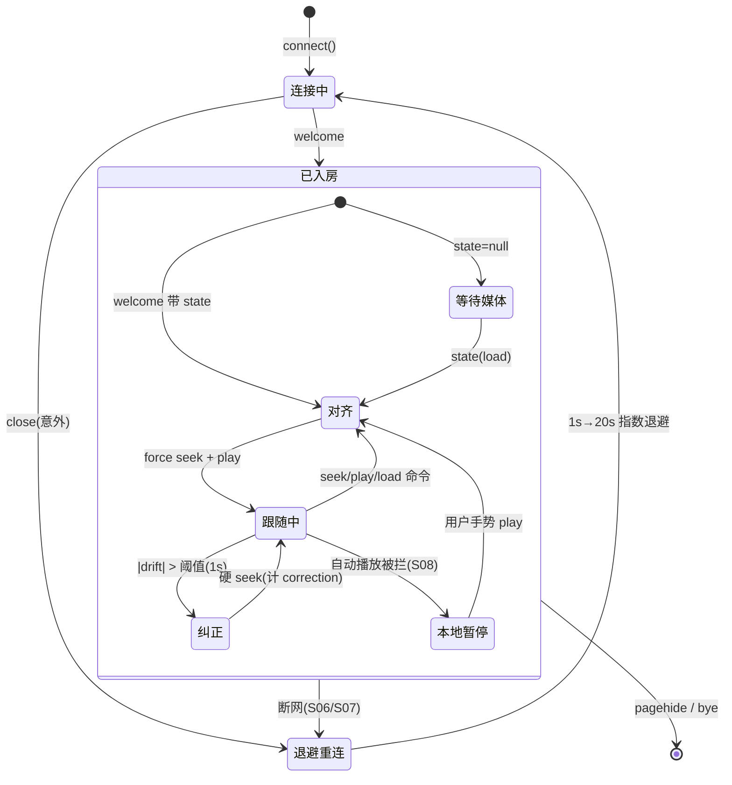

# P2 同步协议草案（Spike 版）

> 状态：Spike 已实现并验证（2026-10-27）。本文是协议草案 + Movi Watch Party 原型审计结论 + 客户端状态机。
> 代码：`packages/sync-protocol/`（共享协议包）、`apps/server/src/sync-rooms.ts`（房间）、`apps/web/src/room-main.ts`（房间页）。

---

## 1. Movi Watch Party 原型审计结论

原型源码：`movi-player` 仓库 `app/watch-party.js`（Cloudflare Durable Object）+ `app/index.html`（客户端，约 line 10839 起）。Spike 复用其协议思路，按验证计划 §3.1 做以下调整：

| 原型做法 | 审计评价 | 本项目决定 |
| --- | --- | --- |
| 服务端为状态盖自家时钟戳，客户端 ping/pong + 最短 RTT 样本估偏移 | 正确且经过实战；偏移更新周期 60s 合理 | 保留；Spike 取 2s 周期换密集样本，融合 median 做 sanity 对照、maxStep 限跳变 |
| 广播原始 `src` URL | 会泄露签名/内部路径 | **改为不透明 `mediaId`**，校验器拒绝 URL 形态（`http(s)://`、`?sign=`） |
| 房主持 OTP secret claim，可 grant/revoke 控制权；房主离开自动提升继承人 | 适合公开产品；与 MVP 权限模型不符 | **仅房主控制**；房主离开→房间暂停 + 30s 宽限期等待重连，**不自动转移**（S15） |
| 同步音轨/字幕选择（atrack/strack 随状态广播） | 多语言房间互相覆盖 | **改为观众本地选择**（S11），状态模型不含轨道 |
| 以 `at` 时间戳判序（`msg.at <= lastStateAt` 丢弃） | 够用但语义混在时钟里 | 改为 **`revision`（定序）+ `mediaRevision`（切换视频）** 显式判序（S14） |
| 所有 controller 都发心跳，各自携带 paused | 观众本地缓冲会反向暂停全房间（注释里的原话教训） | **只有房主说话**；观众永不主动上报状态，自动播放被拦只影响本地（S08/S10） |
| `applyingRemote` 300ms 窗口 + `expectPaused` 15s 窗口抑制回声 | 必要（多 controller 场景） | 结构上消除：服务端不回显发送者，房主不会收到自己的命令 |
| 心跳 10s、硬漂移阈值 1.0s（墙钟预算） | 保留 | 保留；0.5× 下 1s 墙钟 = 0.5s 片长，注释里的预算换算一并保留 |
| 12 人上限、8KB 消息上限、死连接 55s 清扫 | 保留 | 保留 |

## 2. 状态模型

```json
{
  "roomId": "room_01",
  "revision": 42,
  "mediaRevision": 3,
  "mediaId": "media_abc",
  "mediaMeta": { "name": "a.mkv", "size": 123456789 },
  "paused": false,
  "positionMs": 612340,
  "rate": 1,
  "serverTimeMs": 1793049600000,
  "actorId": "host_01",
  "action": "seek"
}
```

- `revision`：服务端单调递增，每次状态变更 +1。客户端丢弃 `revision` 不大于已应用值的任何状态。
- `mediaRevision`：切换视频时 +1。**mediaRevision 更大的状态永远胜出**；更小的永远丢弃（旧视频迟到消息，S14）。
- `serverTimeMs`：服务端单调时钟（`max(Date.now(), last+1)`，回拨防护）。
- `mediaId`：不透明标识。Spike 里直接是 OpenList 路径；P3 改为受控映射 + 短期凭证（计划 §P3）。
- 音量、音轨、字幕、字幕偏移**不在状态里**（观众本地）。

跟随端目标位置（计划 §4.5）：

```text
target = positionMs + (paused ? 0 : max(0, serverNow - serverTimeMs) × rate)
```

## 3. 消息协议

连接：`WS /ws?room=<id>&name=<n>&role=host|viewer&clientId=<稳定id>`（Vite 开发环境经 `/ws` 代理）。

### 客户端 → 服务端

| 消息 | 含义 | 权限 |
| --- | --- | --- |
| `{t:"ping", id}` | 时钟测量 | 所有成员 |
| `{t:"cmd", action:"play"\|"pause", positionMs}` | 播放/暂停 | 仅房主 |
| `{t:"cmd", action:"seek", positionMs}` | 跳转 | 仅房主 |
| `{t:"cmd", action:"rate", rate, positionMs}` | 倍速 | 仅房主 |
| `{t:"cmd", action:"load", mediaId, mediaMeta, positionMs, paused, rate}` | 切换视频 | 仅房主 |
| `{t:"hb", positionMs, paused, rate}` | 状态心跳（5–10s） | 仅房主 |
| `{t:"bye"}` | 主动离开 | 所有成员 |

非房主 `cmd`/`hb` → `{t:"rejected"}` 且房间状态不变（S13）。所有消息经 `parseClientMessage` 形状校验（位置 0–24h、倍速白名单 0.25–4、mediaId 拒绝 URL 形态、消息 ≤8KB）。

### 服务端 → 客户端

| 消息 | 含义 |
| --- | --- |
| `{t:"welcome", you, role, hostId, hostAway, members, state, serverNow}` | 入房；迟到加入/重连在此拿权威状态（S05/S06/S07） |
| `{t:"pong", id, serverNow}` | 时钟测量应答 |
| `{t:"state", ...RoomState}` | 权威状态广播（不回显发送者） |
| `{t:"roster", hostId, hostAway, members}` | 成员变化 |
| `{t:"rejected", reason}` / `{t:"error", code, message}` | 拒绝 / 协议错误 |

## 4. 客户端状态机



要点：

- **观众每 1s 检查一次漂移**：`|本地 - target| > 1s` 才硬 seek（墙钟预算；0.5× 下等于 0.5s 片长）。阈值内不动作，避免画面抖动和 Range 流量浪费（计划 §4.6）。
- **force 对齐**（welcome、seek/play/load 命令、切换视频）不受阈值限制，但目标本身已含 `经过时间×倍速`，不会来回跳（S02）。
- **心跳的作用**只剩小纠偏基准：房主每 8s 报一次位置，服务端盖时间戳广播；漂移纠正完全由观众本地推算，不依赖心跳到达时机。
- **房主本地即权威**：命令先本地应用（保留用户手势上下文以满足自动播放策略），再发送；服务端不回显，房主无需回声抑制。

## 5. 房主离开（S15）

房主断开 → 服务端立即广播 `paused=true` 状态（保留位置）+ `hostAway=true`；30s 宽限期内房主以同一 `clientId` 重连即恢复权威（状态仍暂停，由房主显式 play 恢复——**不自动续播**，行为明确）。宽限期过后仍保持暂停等待，不做自动转移。观众在此期间本地自由（可暂停/拖动只影响自己）。

## 6. 延迟注入（测试设施）

`SYNC_INJECT_LATENCY_MS`（单向）+ `SYNC_INJECT_JITTER_MS`（均匀抖动）统一加在服务端投递路径，仿真 WAN。100ms RTT 场景 = `LATENCY=50, JITTER=30`。仅测试用途，生产默认为 0。

## 7. 已知限制（带入 P3+）

- 房间状态在内存，单进程；多实例需要外部化（计划 §P4）。
- `clientId` 仅由客户端自选，Spike 无鉴权：知道 room+clientId 即可冒名重连。P3 必须换成服务端签发的会话凭证（计划 §P3-4）。
- 心跳/命令无频控（仅形状校验）；公开部署前需加速率限制。
- 时钟偏移假设网络双向对称；严重非对称网络（如单向卫星）下偏移估算有系统误差，依赖心跳硬纠偏兜底。
- 倍速微调（小偏差时短时 1.05×/0.95× 平滑纠偏）未实现，按计划 §4.6 留待后续体验优化。
